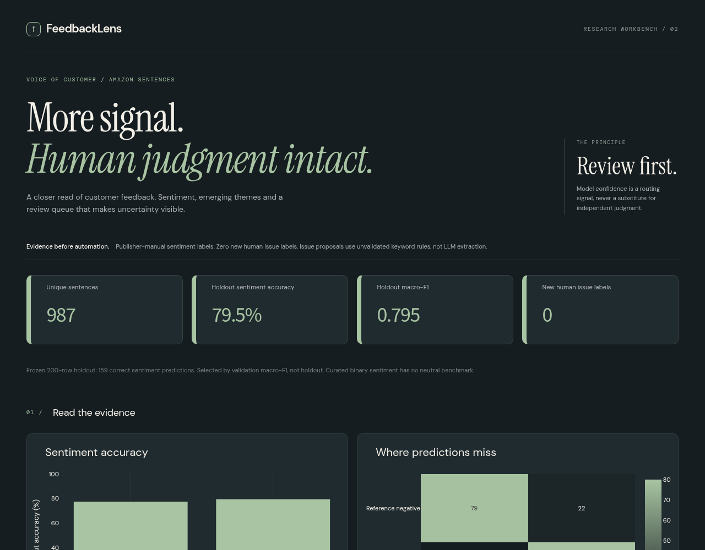

# FeedbackLens

A CPU-only customer-feedback intelligence prototype with SQL deduplication,
sentiment model comparison, exploratory topics, evidence-backed issue proposals
and a blind 200-item review workflow. The dashboard makes uncertainty visible.



**Reviewer map:** [results](#honest-measured-results) · [run](#start-here) ·
[architecture and decisions](docs/reviewer-guide.md) · [data card](docs/data-card.md) ·
[design notes](docs/design-notes.md).

## Business question

Which product experiences should an analyst investigate, and which automated
predictions should be sent for review rather than treated as facts?

One corpus: the Amazon product-review sentence subset of UCI Sentiment Labelled
Sentences. One issue taxonomy: battery/power, audio/calls, fit/usability,
durability/quality, delivery/service, price/value. `other` and `multiple` are
available for human annotation. See [taxonomy and protocol](docs/taxonomy.md).

## Honest measured results

1,000 source sentences -> 987 unique normalized sentences. Fixed stratified split:
587 training, 200 validation, 200 held-out. Text vectorizers and topic factors
fit training text only. Selected by validation macro-F1, threshold unchanged
before holdout evaluation.

| Model | Validation macro-F1 | 200-row holdout accuracy | Holdout macro-F1 |
|---|---:|---:|---:|
| TF-IDF + logistic regression | 0.7993 | 0.7750 | 0.7747 |
| TF-IDF + naive Bayes, selected | 0.8000 | 0.7950 | 0.7950 |

The selected model gets **159/200** publisher reference sentiment labels correct.
These reference labels were manually produced by the dataset authors, not newly
created by Sivasai, an expert panel, or this project's AI assistance.

A confidence threshold of 0.61 was chosen on validation to target 90% accuracy
with at least 40 accepted examples. On holdout it accepts 140/200 (70% coverage)
and gets 124/140 correct (88.57%), below that target. Confidence is not a
guarantee. All issue proposals still need review.

**New human issue labels collected: 0. Issue-taxonomy accuracy: not measured.**
A separate blind labeling page loads only holdout texts and IDs, never predictions
or reference labels. Labels stay in tab memory and export with attribution and
timestamps; closing the tab loses unsaved work. The blind CSV and strict
evaluation script are ready for actual independent
reviewers. A reviewer name in a CSV is self-reported, not authenticated. No
expert-validation or human-in-the-loop improvement metric is claimed.

## Start here

Python 3.10, CPU only. No cloud account, provider key or paid service is needed.
The checked-in artifacts are sufficient to explore the dashboard. Training is a
separate, explicit command, not part of app startup.

```sh
python -m venv .venv
. .venv/bin/activate
python -m pip install -r requirements.txt
python scripts/verify_artifacts.py
streamlit run streamlit_app.py --server.address 127.0.0.1 --server.port 8781
# Open http://127.0.0.1:8781
```

### Reproduce and test

```sh
# Source data is pinned and attributed; download is optional.
python scripts/download_data.py
PYTHONPATH=src python -m feedbacklens.pipeline
python scripts/verify_artifacts.py
PYTHONPATH=src python -m unittest discover -s tests -v
```

The verification command checks the versioned SHA-256 manifest and population
constraints before the app reads the evidence. It catches mixed/missing files;
it does not authenticate a dataset author or make a retrained model equivalent.
If a rerun differs, inspect the source checksum, dependency versions, split IDs
and generated diff. Do not replace the manifest merely to silence a failure.
Review and version any intentional new evidence separately, without selecting
against the existing holdout. See [reviewer guide](docs/reviewer-guide.md).

Optional inference after local training:
`PYTHONPATH=src python -m feedbacklens.predict 'The battery stopped charging.'`
Never load an untrusted joblib file. Optional HTML and blind-review pages:
`python -m http.server 8771 --bind 127.0.0.1`, then `/dashboard/` or
`/dashboard/blind-review.html`. After actual independent annotation, run
`PYTHONPATH=src python -m feedbacklens.review path/to/reviewed.csv`.
No public hosting, Power BI or Tableau implementation is claimed.

## Architecture

UCI Amazon TSV -> SQLite raw -> normalized duplicate removal with window function
-> fixed train/validation/holdout -> TF-IDF sentiment models -> training-only NMF
-> confidence review queue + keyword issue spans -> blind CSV -> reviewer-supplied
labels -> evaluation. Generated results and frozen split IDs are versioned.

[Architecture diagram](docs/architecture.svg). There is no BERTopic, transformer
or LLM extraction in this checkpoint. TF-IDF/NMF and explicit keyword rules are
lighter, reproducible baselines, not equivalent implementations of those tools.
The issue rules abstain when no or multiple keywords match. They do not handle
all negation, sarcasm or multi-issue reviews. Negative sentiment is not validated
severity, financial loss or regulatory risk.

## Data and limitations

[Kotzias et al. (2015), UCI Sentiment Labelled Sentences](https://archive.ics.uci.edu/dataset/331/sentiment+labelled+sentences),
DOI [10.24432/C57604](https://doi.org/10.24432/C57604), CC BY 4.0. Amazon subset
only. The original benchmark deliberately selects clear positive/negative
sentences, with no neutral target. It is small, old, and not representative of
all customer feedback. The data has no dates or revenue: no trend chart or
financial-risk estimate is fabricated. Topic keywords require analyst judgment.
No claims about complaints from other products, languages or markets are made.

A demo video, transformer/LLM comparison, new expert labels and live deployment
remain unfinished. Do not list them as completed experience. Source details and
checksum: [data card](docs/data-card.md).

Optional browser smoke test: install `playwright-core` in a separate Node test
workspace, run the local server, set `NODE_PATH` to its `node_modules`, then run
`node tests/browser/smoke.cjs`. Set `CHROME_BIN` if Chrome is elsewhere. It checks
mobile/desktop overflow and sentiment filtering; screenshots go to `/tmp`.

The blind labeling page is `dashboard/blind-review.html`. It loads a separate
artifact containing only the 200 IDs and texts, not model outputs or reference
labels. Optional browser save/export regression:
`node tests/browser/blind-review.cjs`. The test uses explicitly synthetic fixture
attribution and never adds those labels to results. Design choices:
[notes](docs/design-notes.md).

## Primary Streamlit + Plotly dashboard

```sh
# From this repository root, after installing requirements.txt:
streamlit run streamlit_app.py --server.port 8781
# Open http://127.0.0.1:8781
```

The single page has four KPI cards, four charts (three Plotly + one Altair) and one filtered table (five
visuals excluding KPI cards). It uses the requested graphite/sage/ivory theme in
`.streamlit/config.toml`, with Plotly dark template and 20px chart titles. The
app reads the existing artifacts, never retrains or tunes the model. Interactive
filters and downloads do not change the frozen metrics. AppTest regression
checks are included in the Python test suite. Desktop and mobile rendering
were inspected. No Streamlit Cloud deployment or new remote service is active.

The original HTML dashboard instructions above remain valid as a fallback;
new Streamlit work does not claim to add Power BI, Tableau or expert labels.

### Dashboard design

The Streamlit workbench uses an editorial header, Instrument Serif display type,
DM Sans interface type and DM Mono metadata, bundled as local embedded fonts under
their SIL Open Font Licenses (see `assets/fonts/`). No external font request or
paid design asset is required. Graphite, sage and ivory now form the base palette.
KPI cards form a four-column desktop strip and two-column mobile grid; chart
surfaces, form controls, tables and section dividers share the same spacing.
A short header entrance respects reduced-motion settings. All four KPI values,
four charts (three Plotly + one Altair), filters, scenario controls and evidence limits remain in the page.

Design references, used for direction rather than copied templates:
[Landdding](https://landdding.com), [Godly](https://godly.website),
[Recent](https://recent.design), [Font In Logo](https://fontinlogo.com), and
[Footer Design](https://footer.design). The interface is an original local
implementation, not an endorsement or a purchased template.

## Checks and change policy

Run the evidence verification and Python test commands above before changing
presentation. A hosted CI workflow is not installed in this checkpoint: the
current GitHub token cannot write workflow files. No deployment workflow is
added. Intentional evidence updates need a reviewed artifact diff, source/split
provenance and a separate evaluation decision. Presentation changes should not
change data/model files or the metrics they display.

## Power BI Desktop kit and UI helpers

[Power BI build guide](powerbi/BUILD_GUIDE.md), [data dictionary](powerbi/DATA_DICTIONARY.md)
and the CSV/theme exports are in `powerbi/`. This is an import/build kit for
Windows, not an already built or visually verified `.pbix` report. No Power BI
service publishing or scheduled refresh is configured. Recreate verified exports
with `python scripts/export_powerbi.py`. The same graphite/sage/ivory palette is
used in the local Streamlit dashboard and the Power BI theme.

The local app uses `streamlit-extras.metric_cards` for cards and
`streamlit-option-menu` for a real queue view/order control. Plotly remains
primary; one Altair chart adds a consistent declarative chart surface. There is
no Dash layer, no decorative sidebar and no new data/metric claim. The extras
package has optional component dependencies; only metric styling is used here.
