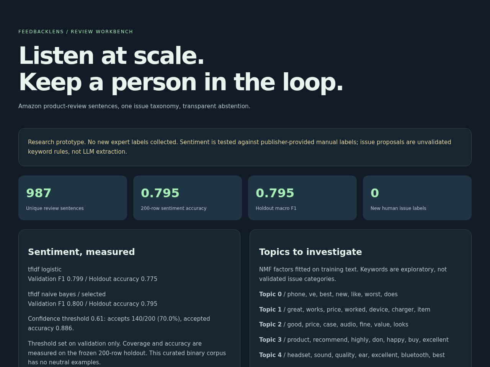

# FeedbackLens

A CPU-only customer-feedback intelligence prototype with SQL deduplication,
sentiment model comparison, exploratory topics, evidence-backed issue proposals
and a blind 200-item review workflow. The dashboard makes uncertainty visible.



## Business question

Which product experiences should an analyst investigate, and which automated
predictions should be sent for review rather than treated as facts?

One corpus: the Amazon product-review sentence subset of UCI Sentiment Labelled
Sentences. One issue taxonomy: battery/power, audio/calls, fit/usability,
durability/quality, delivery/service, price/value. `other` and `multiple` are
available for human annotation. See [taxonomy and protocol](docs/taxonomy.md).

## Honest measured results

1,000 source sentences -> 987 unique normalized sentences. Fixed stratified split:
587 training, 200 validation, 200 held-out. Text vectorizers and topic factors
fit training text only. Selected by validation macro-F1, threshold unchanged
before holdout evaluation.

| Model | Validation macro-F1 | 200-row holdout accuracy | Holdout macro-F1 |
|---|---:|---:|---:|
| TF-IDF + logistic regression | 0.7993 | 0.7750 | 0.7747 |
| TF-IDF + naive Bayes, selected | 0.8000 | 0.7950 | 0.7950 |

The selected model gets **159/200** publisher reference sentiment labels correct.
These reference labels were manually produced by the dataset authors, not newly
created by Sivasai, an expert panel, or this project's AI assistance.

A confidence threshold of 0.61 was chosen on validation to target 90% accuracy
with at least 40 accepted examples. On holdout it accepts 140/200 (70% coverage)
and gets 124/140 correct (88.57%), below that target. Confidence is not a
guarantee. All issue proposals still need review.

**New human issue labels collected: 0. Issue-taxonomy accuracy: not measured.**
The blind CSV and strict evaluation script are ready for actual independent
reviewers. A reviewer name in a CSV is self-reported, not authenticated. No
expert-validation or human-in-the-loop improvement metric is claimed.

## Run locally

```sh
python -m venv .venv
. .venv/bin/activate
pip install -r requirements.txt
# Pinned, attributed source subset is included; optional checksum refresh:
python scripts/download_data.py
PYTHONPATH=src python -m feedbacklens.pipeline
PYTHONPATH=src python -m unittest discover -s tests -v
PYTHONPATH=src python -m feedbacklens.predict 'The battery stopped charging.'
python -m http.server 8771 --bind 127.0.0.1
# Open http://127.0.0.1:8771/dashboard/
# After an actual reviewer labels the complete blind template:
PYTHONPATH=src python -m feedbacklens.review path/to/reviewed.csv
```

Python 3.10. No API key, paid model, cloud or GPU required. Pickled local model
artifacts are generated, not downloaded; never load an untrusted joblib file.
The dashboard is custom HTML, not Power BI or Tableau. No public hosting active.

## Architecture

UCI Amazon TSV -> SQLite raw -> normalized duplicate removal with window function
-> fixed train/validation/holdout -> TF-IDF sentiment models -> training-only NMF
-> confidence review queue + keyword issue spans -> blind CSV -> reviewer-supplied
labels -> evaluation. Generated results and frozen split IDs are versioned.

[Architecture diagram](docs/architecture.svg). There is no BERTopic, transformer
or LLM extraction in this checkpoint. TF-IDF/NMF and explicit keyword rules are
lighter, reproducible baselines, not equivalent implementations of those tools.
The issue rules abstain when no or multiple keywords match. They do not handle
all negation, sarcasm or multi-issue reviews. Negative sentiment is not validated
severity, financial loss or regulatory risk.

## Data and limitations

[Kotzias et al. (2015), UCI Sentiment Labelled Sentences](https://archive.ics.uci.edu/dataset/331/sentiment+labelled+sentences),
DOI [10.24432/C57604](https://doi.org/10.24432/C57604), CC BY 4.0. Amazon subset
only. The original benchmark deliberately selects clear positive/negative
sentences, with no neutral target. It is small, old, and not representative of
all customer feedback. The data has no dates or revenue: no trend chart or
financial-risk estimate is fabricated. Topic keywords require analyst judgment.
No claims about complaints from other products, languages or markets are made.

A demo video, transformer/LLM comparison, new expert labels and live deployment
remain unfinished. Do not list them as completed experience. Source details and
checksum: [data card](docs/data-card.md).

Optional browser smoke test: install `playwright-core` in a separate Node test
workspace, run the local server, set `NODE_PATH` to its `node_modules`, then run
`node tests/browser/smoke.cjs`. Set `CHROME_BIN` if Chrome is elsewhere. It checks
mobile/desktop overflow and sentiment filtering; screenshots go to `/tmp`.
